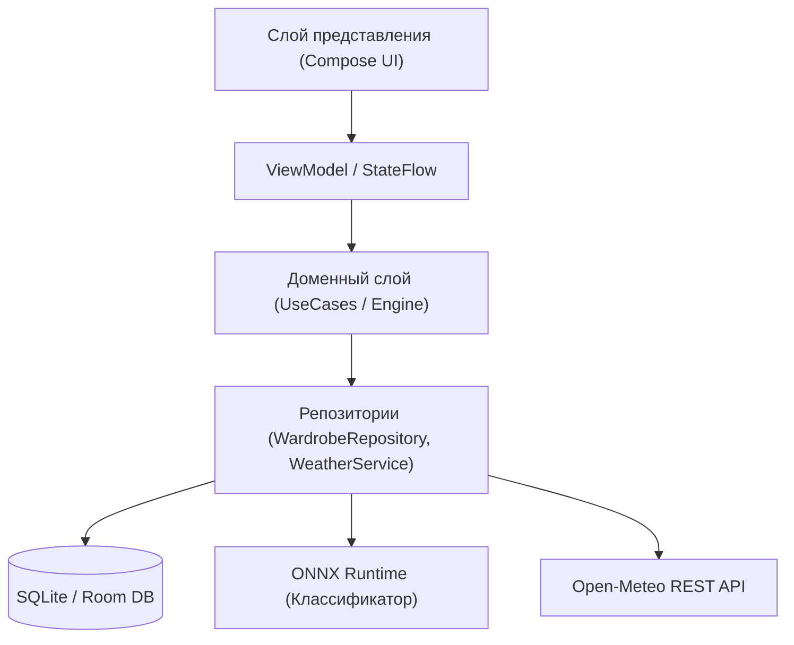

# Этап 2.1: Проектирование архитектуры и реляционной модели БД

## 1. Архитектурная модель
Приложение спроектировано на основе принципов **Clean Architecture** и паттерна **MVVM / MVI**:

## 2. Реляционная схема базы данных (SQLite / Room)
Схема включает таблицы:
- `clothing_items`: реестр одежды (id, title, category_code, color_tone, warmth_level, style_type, is_waterproof, image_path, created_at, updated_at).
- `categories`: классификатор (top, bottom, dress, outerwear, shoes, accessory).
- `weather_cache`: кэшированные ответы метеослужбы.
- B-Tree индексы по `(category_code, warmth_level)`, `style_type`, `is_waterproof`.

## 3. Спецификация ONNX модели
- **Вход:** тензор `[1, 3, 224, 224]` float32 (RGB, ImageNet нормализация);
- **Выход:** Softmax распределение по 6 категориям;
- **Цветовое квантование:** отсечение фона + k-means в пространстве HSV по 12 базовым оттенкам.

## 4. Состав файлов этапа
- `Архитектурная_спецификация_и_модель_БД.docx` – официальный отчет этапа;
- `schema.sql` – DDL создания таблиц, ограничений и индексов SQLite;
- `ClothingEntity.kt` – Room Entity сущность предмета гардероба;
- `ClothingDao.kt` – Data Access Object интерфейс для Room;
- `Enums.kt` – доменные перечисления категорий, стилей, теплоты и событий;
- `AppDatabase.kt` – конфигурация базы данных.
